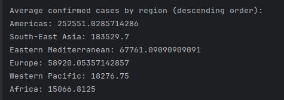
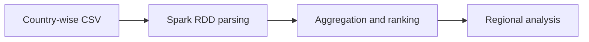
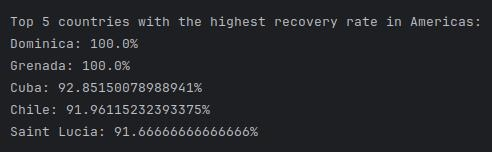

# COVID-19 Analytics with Spark

### Country and region-level exploration of a historical COVID-19 dataset.

**Scala · Apache Spark · RDD transformations**

*Archived coursework / research prototype · Not actively maintained*

A Scala/Spark coursework project analyzing country-wise COVID-19 figures. It explores confirmed cases, deaths, recovery rates, and comparisons across WHO regions.

*Archived console output showing regional confirmed-case averages.*

## What is included

- Country and region aggregations
- Mortality and recovery-rate calculations
- Ranked regional comparisons and console reporting

The repository includes 1 directly browsable source/notebook file and a [source archive](source.zip) containing 1 file with their package structure preserved. See [SOURCE_INDEX.md](SOURCE_INDEX.md) for its contents. Reference components retain their labels and upstream notices.

## Workflow

*Diagram reconstructed from the recovered source or project description.*

## Preserved results and examples

*Archived recovery-rate ranking output from the presentation.*

These are historical artifacts, not fresh executions. Where a report includes scores or rankings, their original evaluation protocol has not been independently reproduced.

## Explore / run

Download `source.zip` and place the country-wise CSV alongside the Scala program. Configure a compatible Scala/Spark environment, review the original data-path setting, and run the `bda` entry point. This repository contains source and historical output captures; it is not a current COVID dashboard.

### Direct source files

- [bda.scala](bda.scala)

## Project status

Screenshots are historical results recovered from the project presentation, not current statistics. The source was not rerun during publication.

No training, benchmark, paid API request, or external service deployment was performed to prepare this showcase. Team names, student IDs, raw personal documents, and embedded credentials are excluded from the public upload copies. Additional scope notes are in [SOURCE_NOTES.md](SOURCE_NOTES.md).
